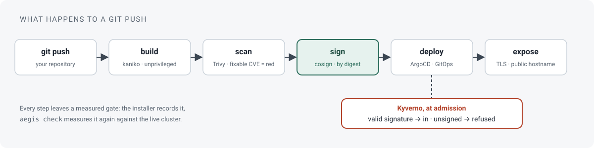
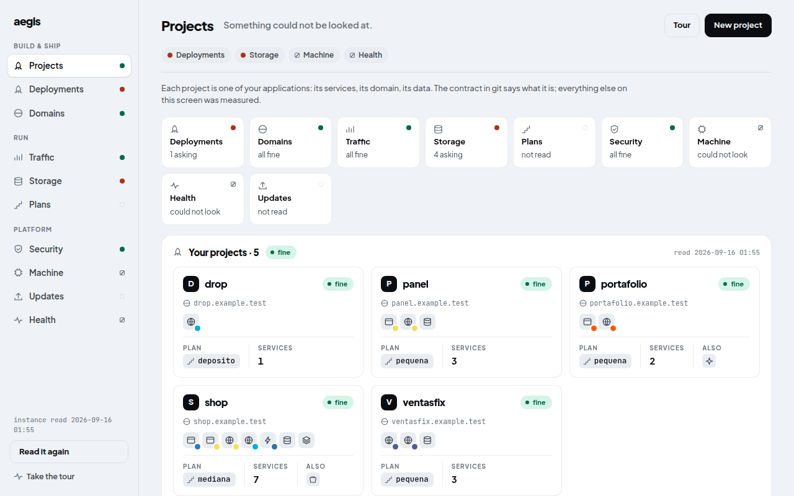
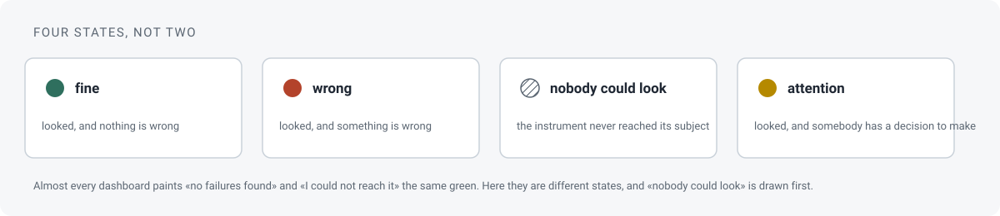
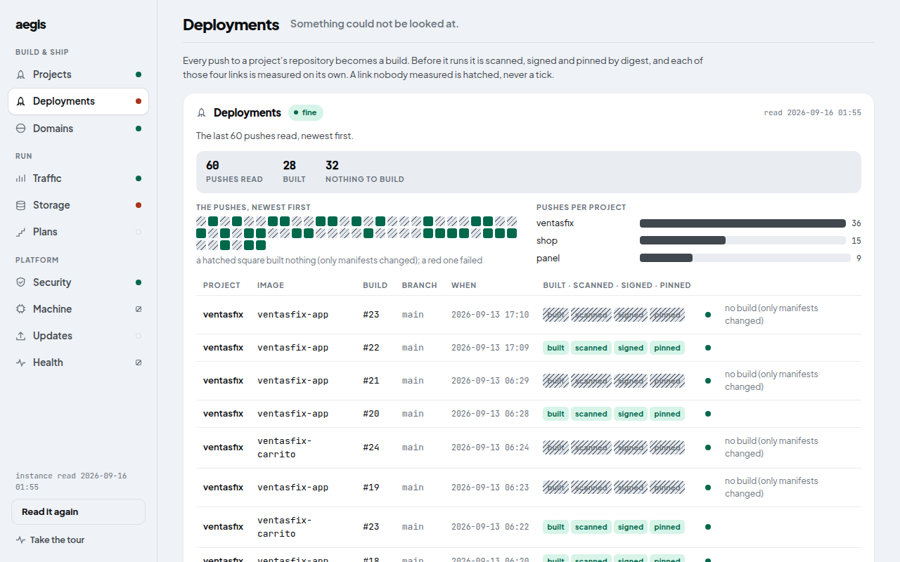
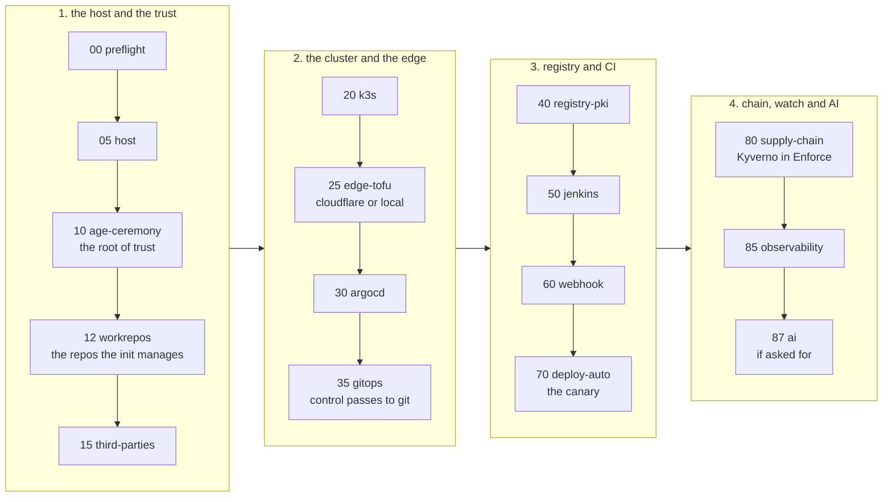
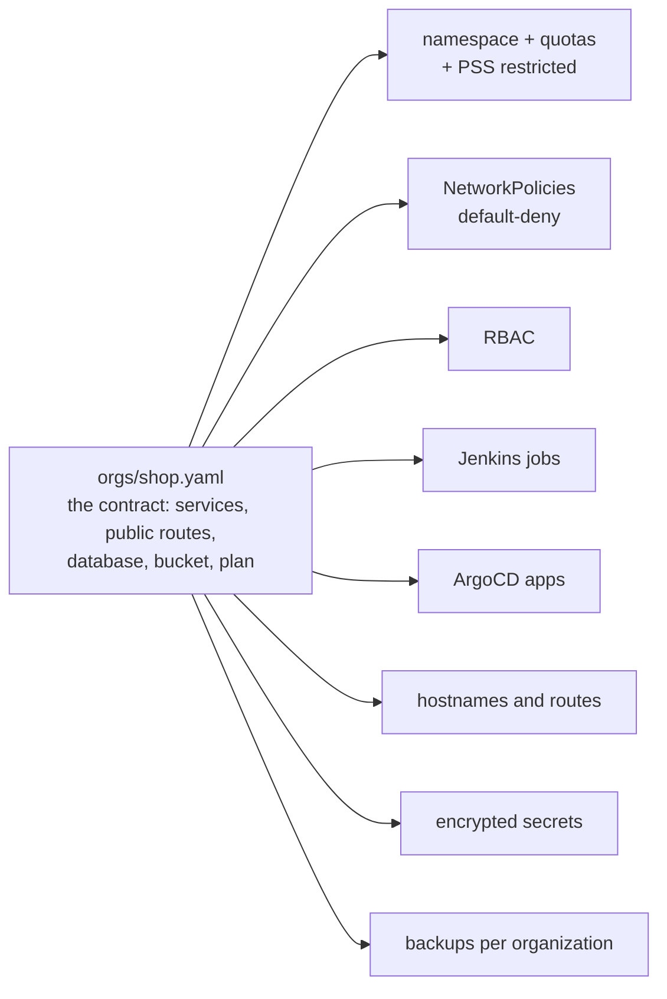

# aegis

**You `git push`. Your server builds, scans, signs and publishes.**

[](https://github.com/MEMEMEMEMEMEMEDev/aegis-infra/actions/workflows/verify.yml)
· Léelo en español: [README.md](README.md)



## What it gives you, in thirty seconds

You have a Linux machine and a GitHub account. One command, `aegis init`,
turns them into a deployment platform of your own: Kubernetes, GitOps,
CI, an image registry, a vulnerability scanner, image signing, metrics,
logs and alerts to your phone, installed and wired together.

From then on:

- **You push and your application is on the internet.** Every push is
  built in an unprivileged pod, scanned, signed, deployed and published
  with TLS at `your-app.your-domain`. You touch no DNS, no certificates,
  no tunnel and no Kubernetes manifest.
- **Nothing runs unsigned.** An image that did not go through your
  pipeline does not enter the cluster: admission refuses it and says why.
- **The server, the data and the keys are yours.** For whoever pushes it
  feels like Vercel; the difference is that nobody else is inside.
- **The platform measures itself and tells you.** A round (`aegis check`)
  and a console say what is fine, what is wrong and, above all, what
  could not be looked at. If it stops reporting, that is a report too.

For whoever operates it, today it is a platform engineering tool: one
person who knows what a cluster is installs it and looks after it. For
the team that pushes, it is a `git push`.

**Status: technical preview** (tag `v3.0.0-alpha.1` of 2026-08-28; 395
fix commits since, as of 2026-10-13). Today, whoever can push to an
application repository is trusted by the whole platform; it becomes a
beta when that, the first item of «What is not there yet», is closed
and validated in a run.

## See it



And this is what the product says about itself, as it came out on
2026-10-13 at commit `d30d41f` (no cluster, in a clean container):

```
$ aegis verify --profile both
══ STATIC VERIFICATION: ALL PASS ══
   profile cloudflare  291 checks, 0 not evaluated
   profile local       291 checks, 0 not evaluated
```

Each of those 291 checks carries its *tooth*: a mutation that proves the
check turns red when it should. The teeth ran too: `aegis verify --teeth`
walks the 1,683 mutations in minutes.

## What has already happened, measured

The figures are left as they came out on the day they were measured. Every
row has its source in the repository.

| when | where | what | result |
|---|---|---|---|
| 2026-08-27 | a rented VPS (4 CPU, 16 GB, Ubuntu, nothing installed but ssh), a fresh GitHub account, no domain (`local` profile) | `aegis init` from zero | 15 of 15 phases (there were fifteen then; 87 came later), 174 gates passed, 20 recorded as not evaluable because they need a public edge. Fourteen resumes and about thirty defects the static checks could not see, all closed with their check |
| 2026-08-27 | the same host | two applications signed up from their contract, with their data restored from backups | 12 products and 4 orders served over HTTPS |
| 2026-08-27 | the same host | the supply chain end to end | a signed image admitted; an unsigned one refused citing the policy |
| 2026-08-27 | the same host | `aegis state backup` and `aegis state restore` into a second instance directory | round trip verified |
| 2026-08-27 | the same host, dirty | `aegis destroy --k3s` and a second `aegis init` over the leftovers | complete, after three fixes to the product; what a previous instance leaves behind, the init detects and repairs |
| 2026-09-22 → 09-24 | lab cloud VMs (Vultr, Ubuntu 26.04; a second one after the first froze), with a zone in Cloudflare | the `cloudflare` profile from zero: tunnel, DNS, Access, Kyverno, the canary | installed; every stop became a fix and a check (Zero Trust dormant, a previous instance's leftovers in Access, a canary sync ArgoCD does not retry) |
| 2026-09-30 → 10-02 | a clean lab install on Arch | phase 80 against two OpenSSL CVEs published the day before | the dated-debt policy was born: what a change brings stops the build; what time brings has a deadline |
| 2026-10-12 → 10-13 | a clean lab install on Ubuntu | from phase 00 to the canary's first signed image | four stops in phase 80, four fixes with their check (the exploited list ageing wrong, golang 1.26.9, the canary repointed twice) |
| in use | the author's home instance, on the `cloudflare` profile: born as v2 and carried to v3 piece by piece on the same seed (the improvements standardised, proven with teeth and on the lab VPSs); not a clean v3 install | the daily routine: pushes, off-site backups, the update window, the vulnerability books every morning | the measured cases the console draws come from here |

What is in the tree today, counted when this page was written:

| | |
|---|---|
| 16 phases | `aegis init --list` |
| 291 static checks, 291 teeth | `aegis verify --list` |
| 30 commands | `aegis --help` |
| 6 application templates | `seed/templates/` |
| 31 ArgoCD Applications in the seed | `seed/platform/k8s/` |
| 8 named failure classes | `seed/platform/docs/failure-modes.md` |
| 395 commits since the `v3.0.0-alpha.1` tag (2026-08-28), as of 2026-10-13 | `git log` |

## Before you start

| | |
|---|---|
| **Host** | **Ubuntu 24.04 or newer**, with `sudo`. Other distributions (Arch, CachyOS, Fedora, Debian, Mint, Pop!_OS) are refused before anything is touched: aegis uses `apt` and Ubuntu's defaults. `amd64` only. |
| **Resources** | 4 CPU and 16 GB of RAM is what has been run. With 8 GB it starts without AI and without margin. 25 GB free on `/`. `aegis host measure` measures your machine; `aegis host budget` says whether what the platform reserves fits in what the machine leaves. |
| **If you share the machine** | With a graphical session, aegis reserves a memory floor for the desktop and never touches it. `aegis host floor --set` changes it. |
| **GPU (optional)** | For the AI's GPU lane: an NVIDIA card with driver 570 or newer. It is shared with your desktop; `aegis host show` says how much VRAM there is. |
| **Network** | Outbound internet over IPv4, a clock on time. The preflight probes and repairs what it can, and switches IPv6 off persistently. |
| **GitHub** | An account with `gh auth login` done and a git identity configured. The init creates two repositories (platform and canary) and then one per application. A dedicated account or organization is the most comfortable. |
| **Cloudflare (optional)** | A zone in your account and **Zero Trust switched on** (free, once, at one.dash.cloudflare.com), for the `cloudflare` profile: public hostnames, a tunnel, Let's Encrypt TLS and the consoles behind Access. Without it, the `local` profile raises the same platform on names that resolve to the host, with TLS from its own CA. |

What to have at hand:

- **A safe place for the age key.** It is the root of trust: it decrypts
  everything, and losing it is losing everything encrypted, backups
  included. Phase 10 generates it, shows it exactly once (in an in-memory
  file you read from another terminal, never on the init's screen) and
  demands a backup it validates for real. Decide beforehand where it
  goes (a password manager, a USB stick, paper) and that it is not the
  same host.
- **With Cloudflare:** the account ID, the zone ID and one master
  credential (the Global API Key, or a token with «Account API Tokens:
  Edit»). The init mints its two scoped tokens with it and does not keep
  it.
- **With no operator present** (`--non-interactive`):
  `AEGIS_AGE_BACKUP_FILE` and, with Cloudflare, `CF_MASTER_FILE`.

You do not need to prepare cosign keys, certificates, DNS records, the
tunnel or the internal registry's credentials. The init generates all of
them.

## Install

```bash
git clone https://github.com/MEMEMEMEMEMEMEDev/aegis-infra && cd aegis-infra
./bin/aegis preflight      # leaves the machine ready, or says what is missing
gh auth login              # your GitHub account: the init creates the repos for you
tmux new -s aegis          # the run is long; a dropped ssh must not kill it
./bin/aegis init           # the wizard asks what it cannot infer, then sixteen phases
```

It takes hours, not minutes. The long phase is 80, which mirrors and
builds the platform's images. From here on this page writes `aegis`
alone: it is `./bin/aegis` from the checkout, and `aegis --help` is the
map.

**What the wizard asks.** The edge profile (`cloudflare` or `local`),
the names of the two repositories, the root domain, whether you want the
AI subsystem (`no`, `cpu` or `gpu`: it decides how much memory is needed)
and, with `cloudflare`, the two IDs. It infers the rest: the GitHub owner
from the `gh` session, the email from `git config`. It prints a summary,
asks for confirmation and writes `~/aegis/aegis.conf`.

**Where everything lives.** This checkout is the product and is not
written to during a run. The instance lives in `~/aegis`: the
configuration in `aegis.conf`, the platform repository in `platform/`,
the phase markers and the gates in `.init-state/`, the encrypted store
in `.state-secrets/`.

**When it finishes.** The consoles hang off the root domain: `argocd.`,
`jenkins.`, `grafana.` and `ntfy.<domain>`. At `aegis.<domain>` lives the
canary, the first application the platform built, signed and deployed.
With `cloudflare` the consoles sit behind Cloudflare Access; with
`local`, the browser will warn until you import the CA. The admin
passwords are born encrypted in `~/aegis/.state-secrets/` and are read
with the age key:

```bash
export SOPS_AGE_KEY_FILE=~/.config/sops/age/aegis.key
sops -d --input-type binary --output-type binary ~/aegis/.state-secrets/jenkins_admin_pass.enc
```

The routine, afterwards:

```bash
aegis check               # measures the live cluster against what is declared; writes nothing
aegis init --list         # which phases exist and which passed
aegis vulns               # what is owed, since when, until when and who fixes it
```

<details>
<summary><b>If it stops</b></summary>

When a phase fails, the init stops there and leaves its gate recorded.
Fix the cause and resume:

```bash
aegis init --from 30      # resume from phase 30
aegis init --only 60      # repeat a single phase
aegis init --check        # measure without changing anything
aegis init-log            # the same as init, leaving a complete dossier of the run
```

`aegis init-log` prints the dossier's path before it starts. The black
box is `.init-state/gates.jsonl`; `docs/OPERATE.md` says where to start
diagnosing. If you are going to ask for help, the issue template «The
install stopped» asks for exactly three things: the `fail` line of that
file, the end of the dossier and, if the cluster answers, `aegis check
--json`.

To start from scratch on the same host:

```bash
aegis destroy             # without --yes it only says what it would remove
aegis destroy --yes --k3s # removes the edge, the bridge and the cluster
aegis init --reset-state  # forgets every gate and starts again
```

`aegis destroy` does not delete the GitHub repositories: they carry a
topic that marks them as the init's own, and a new run reuses them.

</details>

With your own domain in Cloudflare and your GPU, the whole journey is in
[docs/journeys/your-machine.md](docs/journeys/your-machine.md): what to
prepare, what to expect from each phase and what to send when something
stops.

## Your first application

Everything happens in the instance's platform repository. The contracts
live there, in `orgs/`, and that is where the commit is made.

```bash
cd ~/aegis/platform
aegis app new shop --template base   # writes contract, skeleton, derivations and secrets; touches nothing outside
git diff                             # read what it generated
git add -A && git commit -m "org: shop" && git push
aegis sync root                      # ArgoCD picks up the new organization
aegis app apply shop                 # creates the repo, the deploy key and the webhook on GitHub
```

From the first push to the application's repository, the platform builds
it, scans it, signs it, deploys it and exposes it. There are six templates
(`base`, `static`, `service-node`, `service-python`, `service-java`,
`worker-go`) and a template is used once: from there on the contract and
the repository are yours. To change something, edit the contract and
derive again:

```bash
$EDITOR orgs/shop.yaml               # add postgres, a bucket, another service, a secret
aegis org plan orgs/shop.yaml        # what would change, without writing
aegis org apply orgs/shop.yaml       # writes the manifests
aegis secret create orgs/shop.yaml   # if new secrets appeared
aegis app rebase shop                # brings an existing app onto the current pipeline
```

`seed/platform/docs/platform-for-developers.md` is the page for the
team that is going to push: what happens to each push and which rules
reject it.

## The console

```bash
aegis console serve            # http://127.0.0.1:7391
```

A visual layer on top of the CLI. Every screen is drawn from the
documents the commands already emit; it measures nothing of its own and
there is nothing it can run that you cannot. It has no AI agent: a
platform whose job is to say what is true about your machine does not
guess.



It is organized like the consoles you already know: nine screens
(Projects, Deployments, Domains, Traffic, Storage, Plans, Security,
Machine and Health), and beside each entry the worst state of what feeds
it. It opens with your projects and with the repositories nobody runs
yet. It signs a project up in three cards and writes the contract, the
manifests and the secrets that are missing. It does not commit, push,
apply or touch the cluster: ArgoCD reads the remote, so nothing runs
until you commit.



It comes with a guided tour of sixteen steps. It is not published through
the tunnel: you get in with `ssh -L 7391:127.0.0.1:7391`. The why, the
security model and what is missing are in [docs/console.md](docs/console.md).

## The commands

`aegis --help` prints the menu and `aegis <cmd> --help` the detail of
each one. The contract is the same for all of them: `0` done or already
so, `1` wrong or missing, `2` could not evaluate, `3` invalid usage.

| group | commands |
|---|---|
| setup | `aegis preflight`, `aegis init`, `aegis init-log`, `aegis verify`, `aegis destroy` |
| apps | `aegis app`, `aegis org`, `aegis quota`, `aegis repos`, `aegis image`, `aegis secret` |
| operate | `aegis check`, `aegis console`, `aegis update`, `aegis tenant`, `aegis traffic`, `aegis capacity`, `aegis builds`, `aegis vulns`, `aegis host`, `aegis sync`, `aegis seed`, `aegis ai` |
| infra | `aegis ci`, `aegis edge`, `aegis registry`, `aegis rotate`, `aegis webhook` |
| backup | `aegis data`, `aegis state` |

<details>
<summary><b>Every command, in one line</b></summary>

**setup**

| command | what it does |
|---|---|
| `aegis preflight` | Leaves the machine in the state the init needs. With no arguments it acts and repairs. |
| `aegis init` | Brings up the platform phase by phase and records a gate per step. `--from N`, `--only N`, `--check`, `--list`, `--reset-state`, `--configure`, `--non-interactive`. |
| `aegis init-log` | `aegis init` under `script`, leaving a complete dossier of the run. |
| `aegis verify` | The static checks, no cluster. `--profile cloudflare\|local\|both`, `--only NNN`, `--teeth [NNN]`, `--harness`, `--list`. |
| `aegis destroy` | Undoes the init's footprint; `--k3s` the cluster too; `--purge-secrets`, the store. Without `--yes` it only says what it would do. |

**apps**

| command | what it does |
|---|---|
| `aegis app` | `new` writes the whole sign-up to files without touching anything outside; `apply` does the GitHub steps: repo, deploy key, webhook (`--check` to see it first); `rebase` brings an existing app onto the current pipeline. |
| `aegis org` | `plan` shows what would change; `apply` writes the manifests; `validate`, `list`, `schema`, `edge`, `routes`, `plan-delete`, `delete`, `migrate`. |
| `aegis quota` | The plans a project may take. `list`, `add`, `set`, `remove`. Never a number in a contract. |
| `aegis repos` | The account's repositories, with their language and which organization deploys them. |
| `aegis image` | The base images the platform builds and signs. `request`, `list`, `from`, `check`, `gc`. |
| `aegis secret` | `create` the encrypted secrets that are missing; `put` stores a secret the platform cannot invent; `rotate` the material; `move` to another namespace. |

**operate**

| command | what it does |
|---|---|
| `aegis check` | The round: measures the live cluster against what is declared. Writes nothing. |
| `aegis console` | `serve` the console on loopback; `capture` saves a state of the world as a case; `list` the cases; `draw` draws a case's screens with no server. |
| `aegis update` | `inventory` what runs and what exists upstream; `plan` what a window would raise; `window` the whole protocol, dry unless `--yes`; `rollback`, `status`, `metrics`. See [the protocol](seed/platform/docs/protocols/updates.md). |
| `aegis tenant` | One organization as the cluster has it, against what its contract declares. |
| `aegis traffic` | What arrived at each organization, read from Traefik's metrics, reconciled against the total. |
| `aegis capacity` | Does another organization fit? The node against what the plans cost. |
| `aegis builds` | What happened to each push: built, scanned, signed, digest written. |
| `aegis vulns` | The known vulnerabilities of what runs: what is owed, since when, until when and who fixes it. It reads the books image-watch keeps every morning. |
| `aegis host` | `measure` the machine; `show`; `floor` the desktop's memory floor; `budget` whether the platform fits; `reservation` what the node sets aside; `requires` the minimums; `metrics`. |
| `aegis sync` | An ArgoCD sync of the named apps; `--drifted` everything that is not Synced. |
| `aegis seed` | `diff` what the seed changed and this instance lacks; `apply` brings it over keeping pins and derived blocks, in a commit you read and push. |
| `aegis ai` | The operator's control over the AI subsystem: `status`, `start`, `stop`, `open`, `demo`, `max`, `logs`, `engine-logs`, `images`, `bases`, `models`, `seed`, `key`. |

**infra**

| command | what it does |
|---|---|
| `aegis ci` | `build` fires the platform's image jobs in order; `jobs`; `digests`; `quiet on\|off` so that a push does not build on a half-changed platform. |
| `aegis edge` | `check` compares the live hostnames with the ones derived from the contracts. |
| `aegis registry` | `check` the internal registry credential at its ten destinations; `rotate` generates it anew. |
| `aegis rotate` | The rotation protocol: `list`, `check`, `run`, `continue`. It rotates every credential the init generates except the two roots (the age key and the cosign key), which have protocols of their own. |
| `aegis webhook` | `check` that every repository with a job has a webhook; `apply` creates the missing ones. |

**backup**

| command | what it does |
|---|---|
| `aegis data` | The tenants' data, one bundle per organization: `backup`, `list`, `restore`, `size`, `remote` (the off-site destination: `bucket`, `adopt`, `push`, `status`, `cadence`). |
| `aegis state` | `backup` and `restore` of the three states that live only on this machine: the encrypted store, the phase markers and the edge's tfstate. |

`state` is the machine; `data` is the tenants. A backup of one does not
restore the other.

</details>

## How it works, in short

The long version, with every mechanism and every number recomputed, is
[docs/how-it-works.md](docs/how-it-works.md). This is the map.

<details>
<summary><b>Sixteen phases, four stages</b></summary>



Each phase leaves a marker and records its gates in
`.init-state/gates.jsonl`. The order matters: the admission policy is
switched on when a signed image already exists to admit, and
observability goes last because it measures what already exists. The
table of the sixteen phases, one by one, is in `docs/how-it-works.md`.

</details>

<details>
<summary><b>One contract, and everything else derived</b></summary>



One YAML per organization. `aegis org apply` regenerates everything from
the contract, in marked blocks rewritten whole; `aegis org plan` shows
what would change before touching anything. The contract's keys are
Spanish on purpose (`organizacion`, `dominio`, `cuota`, `servicios`):
they are the one vocabulary the product team writes.

</details>

<details>
<summary><b>The supply chain, in six steps</b></summary>

1. A push reaches Jenkins through a webhook (or by polling, with `local`).
2. kaniko builds the image in an unprivileged pod, on a base the
   platform mirrored and signed.
3. Trivy scans, layer by layer. What your change brings with a fixable
   critical or high vulnerability stops the build; what the base brings
   is the platform's and has its own clock; what was already running is
   written down as debt with a date (15 days for a critical, 30 for a
   high), and an exploited vulnerability has no deadline.
4. cosign signs by digest, never by tag, with the instance's key.
5. The pipeline writes the digest into the kustomize overlay and
   commits. ArgoCD deploys.
6. Kyverno, in Enforce, refuses at admission any image without a valid
   signature.

The platform's own images follow the same discipline: one job mirrors
only pinned versions from outside, another builds the owned bases and
tests them by running them before signing them, and `image-watch`
re-scans everything every morning and keeps the books `aegis vulns`
reads.

</details>

<details>
<summary><b>Product and instance, and six rules</b></summary>

This repository is the product: `bin/`, `libexec/` and `lib/` are the
commands; `init/` the phases; `verify/` the checks and their teeth;
`seed/` what ships. It is read-only during a run. The instance is
`~/aegis`: its configuration, its GitOps repository on GitHub, its
markers and its encrypted store. When the product changes, `git pull`
brings the fix to the machine and `aegis seed apply` brings it to the
instance, keeping what is its own.

- The contract is the single source of truth. Everything else is
  derived.
- A command run again with the work done ends in «nothing to do».
- Four outcomes, always: `0` done or already so, `1` wrong or missing,
  `2` could not evaluate, `3` invalid usage. An instrument that never
  reached its subject does not say the subject is fine.
- A gate with no subject is recorded as such. A build that never
  appeared is a failure.
- Every check comes with the mutation that proves it bites
  (`aegis verify --teeth`).
- The product carries nobody's addresses, accounts or paths. Two checks
  watch over it.

</details>

## What is not there yet

Said plainly, because the checks would say it anyway.

- **The trust model is a team's.** Isolation holds between
  organizations; it does not hold between an application repository and
  the platform: today, whoever can push to an application repository is
  trusted by the whole platform. Closing that is the first item of the
  next release.
- As far as the author knows, nobody else has installed the `cloudflare`
  profile from zero yet: it has run on the author's lab machines, and a
  second person is trying it now.
- One repository per service. The monorepo is not first class.
- Restoring between instances is not automatic: the bundle comes
  encrypted with the age key of the instance that made it, and `restore`
  demands `--force` when it detects that the database credential changed.
- Kyverno reaches only registries signed by the instance's CA; a public
  image is refused with an `x509` error, not with «no signature».
- A single node. No HA and no multi-cluster: it is a platform for one
  team and its projects, not for a fleet. A 4-CPU node admits one build
  at a time. Without the AI subsystem, the seed asks for about 5.5 GiB
  of memory and may grow to 14 at its ceilings; with the GPU lane, 16.5
  and 34. `aegis host budget` measures it on your machine.
- `amd64` only, and Ubuntu only on the host.
- The contract's keys are Spanish on purpose; elsewhere in the product
  Spanish identifiers remain to be retired, and the glossary lists them.
- The VRAM watcher only warns. When the desktop and the engines run out
  of card, aegis says so and takes nothing down.
- The console is the operator's. It runs on loopback and is reached
  over an SSH tunnel. The tenant's console does not exist.
- The console adds and changes, and never removes. Deleting a service is
  `aegis org` by hand.
- Outside the console, it still demands reading.

Next, in this order and with no dates: closing the trust model between
tenant and platform; the `cloudflare` profile installed by a second
person; the tenant's console; the monorepo as a first-class case.

## What is inside

```
bin/          the dispatcher (aegis <command>)
libexec/      one file per command
lib/          the shared helpers, bash and python
init/         the orchestrator and its sixteen phases
verify/       the checks, their teeth, the harnesses
seed/         what ships: the platform repo, the canary, the templates
console/      the measured cases the console is drawn and tested with
share/        the exit codes, the systemd units, the console's CSS
docs/         how it works, how it is operated, how it is changed; the glossary; the journeys
.github/      the verification on every push, and the issue and PR templates
```

In the cluster: k3s without the stock Traefik and servicelb, installed by
Ansible; ArgoCD with KSOPS; Jenkins with jobs as code and kaniko; Trivy,
cosign and Kyverno; Traefik and cert-manager with an internal CA;
cloudflared only with `cloudflare`; an internal image registry with its
own TLS; Garage (S3) and Postgres, MongoDB and Redis as service types,
with a bucket and a database per organization; VictoriaMetrics,
VictoriaLogs, Grafana, Vector, blackbox-exporter, Alertmanager and ntfy;
default-deny NetworkPolicies and PSS restricted in every tenant
namespace. Every version is pinned where it is used and `aegis update
inventory` reads them all.

Where to keep reading:

- [docs/how-it-works.md](docs/how-it-works.md), the long version of
  this page: phases, GitOps, the chain, tenants, secrets, backups, the
  verifier.
- [docs/journeys/your-machine.md](docs/journeys/your-machine.md), if you
  are going to install it with your domain and your GPU.
- [docs/OPERATE.md](docs/OPERATE.md), if you are going to operate an
  instance: expected state, diagnosis, recovery tools.
- [docs/console.md](docs/console.md), if you are going to use the
  console.
- [docs/AGENTS.md](docs/AGENTS.md), if you are going to change the
  product: the method and the rules born from real incidents.
- `docs/glossary.md` is the vocabulary, and `aegis verify` enforces it.
- `seed/platform/docs/failure-modes.md` catalogues the failure classes
  with their signature and their fix.
- `seed/platform/docs/platform-for-developers.md` is what the team that
  pushes reads.

## About the language and the history

The product is in English: code, messages, the seed and the
documentation. The Spanish README is the front page; this is the English
version. The commit history is a working record: in Spanish until
September 2026 and in English since, and it tells how each bug was
found.

This history begins with the v3 rebuild. The earlier work (version 2)
lives in private repositories, because it carries the identity of one
particular instance: the author's, which was born on v2 and carried to
v3. This project did not come out of one session or one
prompt: every piece above has runs that failed behind it, and checks
that were born from them.

## Contributing, security, licence

- `CONTRIBUTING.md`: one item, one commit; one check per fix; one tooth
  per check; `aegis verify --profile both` green before committing.
  Nothing is done until a run validates it on a real instance.
- `SECURITY.md`: how to report a vulnerability privately, through this
  repository's private GitHub reporting, never in a public issue.
- Apache License, version 2.0; see `LICENSE`.
