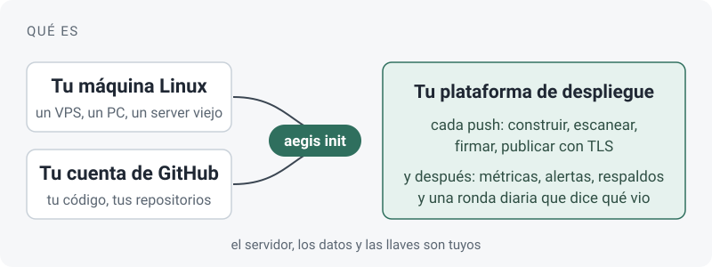
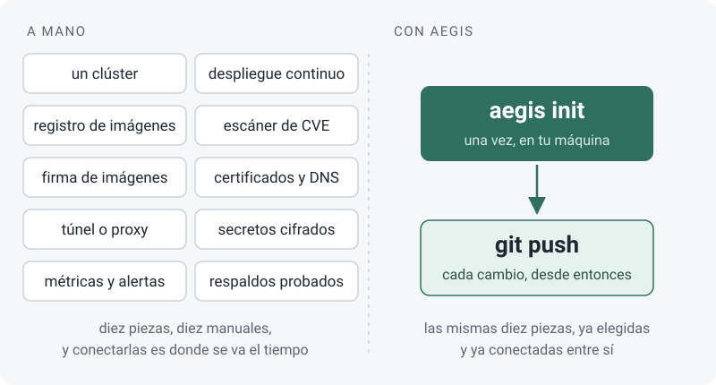
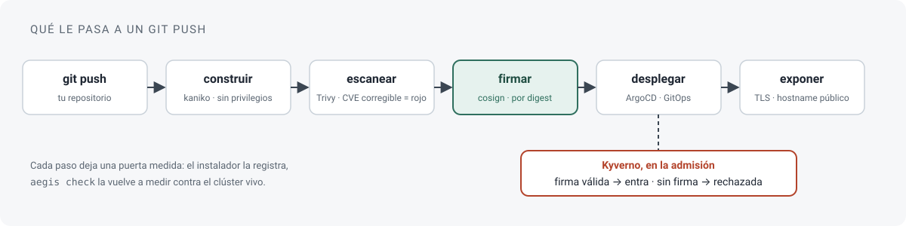
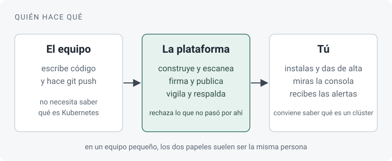
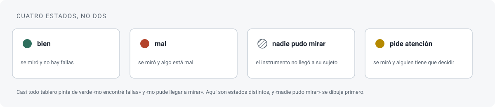
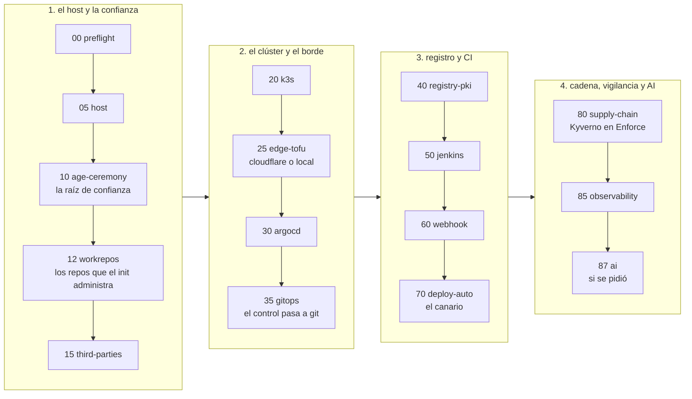
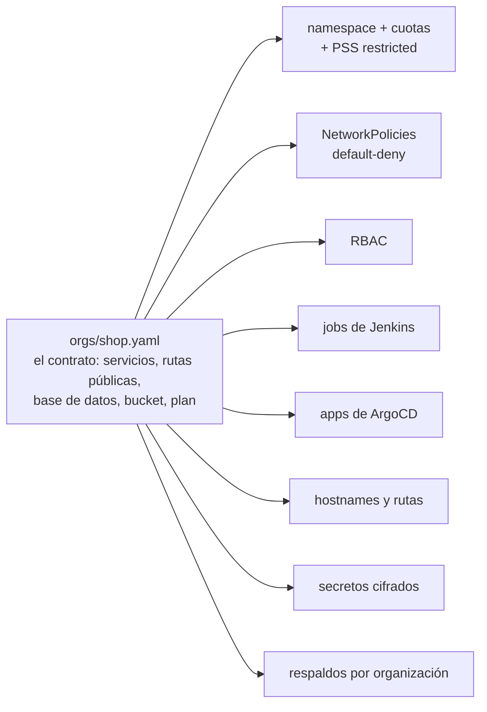

# aegis

**Haces `git push`. Tu servidor construye, escanea, firma y publica.**

[](https://github.com/MEMEMEMEMEMEMEDev/aegis-infra/actions/workflows/verify.yml)
· Read this in English: [README.en.md](README.en.md)



## En una frase

aegis convierte una máquina Linux y una cuenta de GitHub en tu propia
plataforma de despliegue. Instala y conecta todo lo que hace falta para
que un `git push` termine en una aplicación publicada en internet, con
certificado, escaneada y firmada, y después vigila que siga así. Es
software libre, corre en tu servidor y las llaves son tuyas.

Para quien hace push, se parece a Vercel o a Heroku. La diferencia es
que no hay nadie más dentro.

## Para quién es

- **Para quien tiene un servidor y varias aplicaciones.** Un VPS, una
  máquina en casa, un equipo viejo con Linux. Hoy publicas a mano,
  copiando ficheros o levantando contenedores uno a uno, y cada cambio
  es una tarde. Con aegis, el cambio es un push.
- **Para un equipo pequeño que quiere trabajar como los grandes sin
  pagar como los grandes.** Cada proyecto en su sitio, con su base de
  datos, su dominio y sus respaldos, y un flujo igual para todos: push,
  construir, probar, publicar.
- **Para quien no quiere regalar sus llaves.** Las plataformas
  comerciales son cómodas porque guardan tu código, tus secretos y tus
  datos. aegis te da la misma comodidad en tu máquina: el código en tu
  GitHub, los secretos cifrados en tu disco, los datos en tu servidor.
- **Para quien quiere entender qué corre.** Nada está escondido. Cada
  pieza es una herramienta conocida, cada decisión está escrita y la
  plataforma se mide a sí misma todos los días y te dice qué encontró.

No es para una empresa con decenas de equipos ni para alojar a
desconocidos. Es para un equipo y sus proyectos.

## Qué problema resuelve

Montar una plataforma así a mano es un proyecto en sí mismo: un clúster,
un sistema de despliegue continuo, un registro de imágenes, un escáner
de vulnerabilidades, firmas, certificados, DNS, túneles, métricas, logs,
alertas y respaldos. Cada pieza tiene su manual y su forma de romperse,
y conectarlas entre sí es donde se va el tiempo. La mayoría de la gente
lo deja a medias: publica sin escanear, guarda secretos en ficheros
sueltos, no tiene respaldos probados, y nunca sabe si algo está mal
hasta que un usuario avisa.



aegis hace ese trabajo de una vez, con las piezas ya elegidas y ya
conectadas, y con una regla que vale para todo: **si algo no se pudo
comprobar, se dice.** Una plataforma que calla cuando no sabe es peor
que una que no existe.

## Qué hace



- **Instala la plataforma entera con un comando.** `aegis init` pregunta
  lo poco que no puede deducir y recorre dieciséis fases. Cada fase deja
  constancia de lo que comprobó. Si algo falla, se detiene ahí, dice por
  qué y se puede reanudar.
- **Convierte cada push en una publicación.** La aplicación se construye
  en un entorno aislado, se escanea en busca de vulnerabilidades, se firma
  y se despliega. Queda publicada con TLS en `tu-app.tu-dominio`, sin
  que toques DNS ni certificados.
- **No deja correr nada que no haya pasado por ahí.** Una imagen sin
  firma no entra al clúster. La plataforma la rechaza y dice por qué.
- **Da de alta un proyecto con un fichero.** Un contrato por proyecto
  dice qué servicios tiene, qué base de datos, qué dominio y cuánto puede
  consumir. Todo lo demás se deriva de ahí.
- **Se vigila a sí misma.** Métricas, logs, una ronda diaria de
  comprobaciones y alertas al teléfono. Cada mañana vuelve a escanear lo
  que corre y lleva un libro de lo que se debe arreglar y hasta cuándo.
- **Hace respaldos y sabe restaurarlos.** Los datos de cada proyecto y el
  estado de la propia plataforma, cifrados, con la restauración probada.

## Quién hace qué



Hay dos papeles. **El equipo** escribe código y hace push; no necesita
saber qué es Kubernetes. **Quien opera** instala aegis, da de alta los
proyectos y mira la consola de vez en cuando; conviene que sepa qué es
un clúster, porque cuando algo se frena, el diagnóstico es suyo. En un
equipo pequeño suelen ser la misma persona.

## Qué no hace

Dicho antes de que lo descubras:

- **No es para alojar a terceros.** Quien puede hacer push a un
  proyecto es de confianza para toda la plataforma. Los proyectos están
  aislados entre sí, pero no de la plataforma. Es una decisión: aegis es
  para un equipo que se aloja a sí mismo.
- **Una sola máquina.** Sin alta disponibilidad ni varios nodos. Si la
  máquina se cae, la plataforma se cae con ella; los respaldos existen
  para volver.
- **Un solo sistema operativo en el host.** Ubuntu, y nada más por
  ahora. Otras distribuciones se rechazan antes de tocar nada.
- **No tiene panel web para administrar.** La consola muestra; el
  cambio se hace con comandos y commits. Es a propósito: nada corre
  hasta que tú lo commiteas.
- **No es instantáneo.** La instalación tarda horas, no minutos, porque
  construye y firma sus propias imágenes. Después, un push tarda lo que
  tarda construir tu aplicación.
- **Exige leer.** Hay un asistente para instalar y una consola para
  mirar, pero operar una plataforma es operar una plataforma.

La lista completa, medida, está más abajo en «Lo que no está».

## Cómo se ve


La consola se abre en tu navegador por un túnel SSH y muestra tus
proyectos, los despliegues, los dominios, el tráfico, el almacenamiento,
la seguridad y la máquina. Cada cosa tiene uno de cuatro estados:



El cuarto estado es el importante. Cuando algo no se pudo medir, la
consola no lo pinta de verde: lo dice.


## Estado

**Versión alpha.** Es la primera versión que otra persona puede instalar
desde este repositorio. Funciona, está probada y se usa a diario en la
instancia del autor, pero todavía la ha instalado poca gente y es
probable que tu máquina encuentre algo que las del autor no. Si pasa,
hay una plantilla de issue que pide exactamente lo que hace falta para
diagnosticarlo.

Dónde ha corrido una instalación completa, desde cero y sin
intervención:

| sistema | resultado |
|---|---|
| Ubuntu 26.04, en VMs de laboratorio | varias instalaciones limpias de principio a fin, con el dominio en Cloudflare, una aplicación publicada y la recuperación desde respaldo probada |
| Ubuntu, en un VPS alquilado | la primera instalación completa, con el perfil sin dominio |
| Arch Linux y Debian 13, en laboratorio | instalaciones limpias por el carril experimental; el instalador aún no las acepta fuera del laboratorio |
| la máquina del autor, Ubuntu con GPU | en uso diario: pushes, respaldos fuera de sitio, actualizaciones y el libro de vulnerabilidades cada mañana |

Cada corrida que falló dejó un arreglo y una comprobación que lo
vigila. Lo que el producto dice de sí mismo, tal cual salió el
2026-10-14 sobre el árbol del commit `39d2405` (sin clúster):

```
$ aegis verify --profile both
══ STATIC VERIFICATION: ALL PASS (292 checks, 1 not evaluated) ══
   no check reads the profile yet (AEGIS_VERIFY_PROFILE): both profiles are one pass, run once as cloudflare — the second comes back the day a check reads it
```

Cada uno de esos 293 checks lleva su *diente*: una mutación que
demuestra que el check se pone rojo cuando debe. `aegis verify --teeth`
recorre las 1.688 mutaciones en minutos. Los detalles de cada corrida,
con sus cifras tal como salieron, están en
[docs/how-it-works.md](docs/how-it-works.md).

## Antes de empezar

| | |
|---|---|
| **Host** | **Ubuntu 24.04 o superior**, **Debian 13 o superior** o **Arch Linux (rolling)**, con `sudo`. Arch y los derivados que declaren `ID_LIKE=arch` están soportados. Otras distribuciones (Fedora, Mint, Pop!_OS) se rechazan antes de tocar nada. Solo `amd64`. |
| **Recursos** | 4 CPU y 16 GB de RAM es lo que se ha corrido. Con 8 GB arranca sin AI y sin margen. 25 GB libres en `/`. `aegis host measure` mide tu máquina; `aegis host budget` dice si lo que la plataforma reserva entra en lo que la máquina deja. |
| **Si compartes la máquina** | Con sesión gráfica, aegis reserva un piso de memoria para el escritorio y no lo toca. `aegis host floor --set` lo cambia. |
| **GPU (opcional)** | Para el carril de GPU de la AI: una NVIDIA con driver 570 o superior. Se comparte con tu escritorio; `aegis host show` dice cuánta VRAM hay. |
| **Red** | Salida a internet por IPv4, reloj en hora. El preflight sondea y corrige lo que puede, y apaga IPv6 de forma persistente. |
| **GitHub** | Una cuenta con `gh auth login` hecho e identidad git configurada. El init crea dos repositorios (plataforma y canario) y después uno por aplicación. Una cuenta u organización dedicada es lo más cómodo. |
| **Cloudflare (opcional)** | Una zona en tu cuenta y **Zero Trust encendido** (gratis, una vez, en one.dash.cloudflare.com), para el perfil `cloudflare`: hostnames públicos, túnel, TLS de Let's Encrypt y las consolas detrás de Access. Sin ella, el perfil `local` levanta la misma plataforma sobre nombres que resuelven al host, con TLS de la CA propia. |

Qué tener a mano:

- **Un lugar seguro para la clave age.** Es la raíz de confianza:
  descifra todo, y perderla es perder todo lo cifrado, respaldos
  incluidos. La fase 10 la genera, la muestra una sola vez (en un fichero
  en memoria que lees desde otra terminal, nunca en la pantalla del init)
  y exige un respaldo que valida de verdad. Decide antes dónde va (gestor
  de contraseñas, USB, papel) y que no sea el mismo host.
- **Con Cloudflare:** el ID de cuenta, el ID de zona y una credencial
  maestra (la Global API Key, o un token con «Account API Tokens:
  Edit»). El init crea con ella sus dos tokens acotados y no la guarda.
- **Sin operador delante** (`--non-interactive`): `AEGIS_AGE_BACKUP_FILE`
  y, con Cloudflare, `CF_MASTER_FILE`.

No hace falta preparar claves de cosign, certificados, registros DNS,
el túnel ni las credenciales del registro interno. Todo eso lo genera
el init.

## Instalar

```bash
git clone https://github.com/MEMEMEMEMEMEMEDev/aegis-infra && cd aegis-infra
./bin/aegis preflight      # deja la máquina lista, o dice qué falta
gh auth login              # tu cuenta de GitHub: el init crea los repos por ti
tmux new -s aegis          # la corrida es larga; que un ssh caído no la mate
./bin/aegis init           # el asistente pregunta lo que no puede inferir, y luego dieciséis fases
```

Tarda horas, no minutos. La fase larga es la 80, que espeja y construye
las imágenes de la plataforma. En adelante esta página escribe `aegis`
a secas: es `./bin/aegis` desde el checkout, y `aegis --help` es el
mapa.

**Lo que pregunta el asistente.** El perfil de borde (`cloudflare` o
`local`), los nombres de los dos repositorios, el dominio raíz, si
quieres el subsistema de AI (`no`, `cpu` o `gpu`: decide cuánta memoria
hace falta) y, con `cloudflare`, los dos ID. El resto lo deduce: el dueño
de GitHub de la sesión de `gh`, el correo de `git config`. Muestra un
resumen, pide confirmación y escribe `~/aegis/aegis.conf`.

**Dónde queda cada cosa.** Este checkout es el producto y no se escribe
durante una corrida. La instancia vive en `~/aegis`: la configuración en
`aegis.conf`, el repositorio de plataforma en `platform/`, los marcadores
de fase y las puertas en `.init-state/`, el almacén cifrado en
`.state-secrets/`.

**Cuando termina.** Las consolas cuelgan del dominio raíz: `argocd.`,
`jenkins.`, `grafana.` y `ntfy.<dominio>`. En `aegis.<dominio>` vive el
canario, la primera aplicación que la plataforma construyó, firmó y
desplegó. Con `cloudflare` las consolas quedan detrás de Cloudflare
Access; con `local`, el navegador avisará hasta que importes la CA. Las
contraseñas de administración nacen cifradas en `~/aegis/.state-secrets/`
y se leen con la clave age:

```bash
export SOPS_AGE_KEY_FILE=~/.config/sops/age/aegis.key
sops -d --input-type binary --output-type binary ~/aegis/.state-secrets/jenkins_admin_pass.enc
```

La rutina, después:

```bash
aegis check               # mide el clúster vivo contra lo declarado; no escribe nada
aegis init --list         # qué fases hay y cuáles pasaron
aegis vulns               # qué se debe, desde cuándo, hasta cuándo y quién lo arregla
```

<details>
<summary><b>Si se cae</b></summary>

Cuando una fase falla, el init se detiene en ella y deja su puerta
registrada. Arregla la causa y reanuda:

```bash
aegis init --from 30      # reanuda desde la fase 30
aegis init --only 60      # repite una sola fase
aegis init --check        # mide sin cambiar nada
aegis init-log            # lo mismo que init, dejando un dosier completo de la corrida
```

`aegis init-log` imprime la ruta del dosier antes de empezar. La caja
negra es `.init-state/gates.jsonl`; `docs/OPERATE.md` dice por dónde
empezar a diagnosticar. Si vas a pedir ayuda, la plantilla de issue
«The install stopped» pide exactamente tres cosas: la línea `fail` de ese
fichero, el final del dosier y, si el clúster responde, `aegis check
--json`.

Para empezar de cero sobre el mismo host:

```bash
aegis destroy             # sin --yes solo dice qué quitaría
aegis destroy --yes --k3s # quita el borde, el puente y el clúster
aegis init --reset-state  # olvida todas las puertas y vuelve a empezar
```

`aegis destroy` no borra los repositorios de GitHub: llevan un topic
que los marca como propios del init, y una nueva corrida los reutiliza.

</details>

Con tu propio dominio en Cloudflare y tu GPU, el viaje completo está en
[docs/journeys/your-machine.md](docs/journeys/your-machine.md): qué
preparar, qué esperar de cada fase y qué mandar cuando algo se frena.

## Tu primera aplicación

Todo ocurre en el repositorio de plataforma de la instancia. Ahí viven
los contratos, en `orgs/`, y ahí se hace el commit.

```bash
cd ~/aegis/platform
aegis app new shop --template base   # escribe contrato, esqueleto, derivaciones y secretos; no toca nada fuera
git diff                             # lee lo que generó
git add -A && git commit -m "org: shop" && git push
aegis sync root                      # ArgoCD recoge la organización nueva
aegis app apply shop                 # crea el repo, la deploy key y el webhook en GitHub
```

Desde el primer push al repositorio de la aplicación, la plataforma la
construye, escanea, firma, despliega y expone. Hay seis plantillas
(`base`, `static`, `service-node`, `service-python`, `service-java`,
`worker-go`) y la plantilla se usa una vez: desde ahí el contrato y el
repositorio son tuyos. Para cambiar algo, editas el contrato y vuelves a
derivar:

```bash
$EDITOR orgs/shop.yaml               # añadir postgres, un bucket, otro servicio, un secreto
aegis org plan orgs/shop.yaml        # qué cambiaría, sin escribir
aegis org apply orgs/shop.yaml       # escribe los manifiestos
aegis secret create orgs/shop.yaml   # si aparecieron secretos nuevos
aegis app rebase shop                # trae una app existente al pipeline actual
```

`seed/platform/docs/platform-for-developers.md` es la página para el
equipo que va a hacer push: qué pasa con cada push y qué reglas lo
rechazan.

## La consola

```bash
aegis console serve            # http://127.0.0.1:7391
```

Una capa visual encima de los comandos. Cada pantalla se dibuja con los
documentos que los comandos ya emiten; no mide nada por su cuenta y no
puede correr nada que tú no puedas. No tiene agente de AI: una
plataforma cuyo trabajo es decir qué es verdad sobre tu máquina no
adivina.

Está organizada como las consolas que ya conoces: nueve pantallas
(Projects, Deployments, Domains, Traffic, Storage, Plans, Security,
Machine y Health) y al lado de cada entrada el peor estado de lo que la
alimenta. Da de alta un proyecto en tres tarjetas y escribe el contrato,
los manifiestos y los secretos que falten. No commitea, no empuja, no
aplica y no toca el clúster: nada corre hasta que tú commitees.

Trae un recorrido guiado de dieciséis pasos. No se publica por el túnel:
se entra con `ssh -L 7391:127.0.0.1:7391`. El porqué, el modelo de
seguridad y lo que falta están en [docs/console.md](docs/console.md).

## Los comandos

`aegis --help` imprime el menú y `aegis <cmd> --help` el detalle de cada
uno. El contrato es el mismo para todos: `0` hecho o ya estaba, `1` mal o
falta, `2` no se pudo evaluar, `3` uso inválido.

| grupo | comandos |
|---|---|
| setup | `aegis preflight`, `aegis init`, `aegis init-log`, `aegis verify`, `aegis destroy` |
| apps | `aegis app`, `aegis org`, `aegis quota`, `aegis repos`, `aegis image`, `aegis secret` |
| operate | `aegis check`, `aegis console`, `aegis update`, `aegis tenant`, `aegis traffic`, `aegis capacity`, `aegis builds`, `aegis vulns`, `aegis host`, `aegis sync`, `aegis seed`, `aegis ai` |
| infra | `aegis ci`, `aegis edge`, `aegis registry`, `aegis rotate`, `aegis webhook` |
| backup | `aegis data`, `aegis state` |

<details>
<summary><b>Cada comando, en una línea</b></summary>

**setup**

| comando | qué hace |
|---|---|
| `aegis preflight` | Deja la máquina en el estado que el init necesita. Sin argumentos actúa y repara. |
| `aegis init` | Levanta la plataforma fase por fase y registra una puerta por paso. `--from N`, `--only N`, `--check`, `--list`, `--reset-state`, `--configure`, `--non-interactive`. |
| `aegis init-log` | `aegis init` bajo `script`, dejando un dosier completo de la corrida. |
| `aegis verify` | Los checks estáticos, sin clúster. `--profile cloudflare\|local\|both`, `--only NNN`, `--teeth [NNN]`, `--harness`, `--list`. |
| `aegis destroy` | Deshace la huella del init; `--k3s` también el clúster; `--purge-secrets`, el almacén. Sin `--yes` solo dice qué haría. |

**apps**

| comando | qué hace |
|---|---|
| `aegis app` | `new` escribe el alta entera en ficheros sin tocar nada fuera; `apply` hace los pasos de GitHub: repo, deploy key, webhook (`--check` para verlo antes); `rebase` trae una app existente al pipeline actual. |
| `aegis org` | `plan` muestra qué cambiaría; `apply` escribe los manifiestos; `validate`, `list`, `schema`, `edge`, `routes`, `plan-delete`, `delete`, `migrate`. |
| `aegis quota` | Los planes que un proyecto puede tomar. `list`, `add`, `set`, `remove`. Nunca un número en un contrato. |
| `aegis repos` | Los repositorios de la cuenta, con su lenguaje y qué organización los despliega. |
| `aegis image` | Las imágenes base que la plataforma fabrica y firma. `request`, `list`, `from`, `check`, `gc`. |
| `aegis secret` | `create` los secretos cifrados que faltan; `put` guarda un secreto que la plataforma no puede inventar; `rotate` el material; `move` a otro namespace. |

**operate**

| comando | qué hace |
|---|---|
| `aegis check` | La ronda: mide el clúster vivo contra lo declarado. No escribe nada. |
| `aegis console` | `serve` la consola en loopback; `capture` guarda un estado del mundo como caso; `list` los casos; `draw` dibuja las pantallas de un caso sin servidor. |
| `aegis update` | `inventory` qué corre y qué existe río arriba; `plan` qué subiría una ventana; `window` el protocolo entero, en seco salvo `--yes`; `rollback`, `status`, `metrics`. Ver [el protocolo](seed/platform/docs/protocols/updates.md). |
| `aegis tenant` | Una organización como el clúster la tiene, contra lo que su contrato declara. |
| `aegis traffic` | Lo que llegó a cada organización, leído de las métricas de Traefik, reconciliado contra el total. |
| `aegis capacity` | ¿Entra otra organización? El nodo contra lo que los planes cuestan. |
| `aegis builds` | Qué le pasó a cada push: construir, escanear, firmar, anotar el digest. |
| `aegis vulns` | Las vulnerabilidades conocidas de lo que corre: qué se debe, desde cuándo, hasta cuándo y quién lo arregla. Lo lee del libro que image-watch lleva cada mañana. |
| `aegis host` | `measure` la máquina; `show`; `floor` el piso de memoria del escritorio; `budget` si la plataforma entra; `reservation` lo que el nodo aparta; `requires` los mínimos; `metrics`. |
| `aegis sync` | Un sync de ArgoCD de las apps nombradas; `--drifted` todo lo que no esté Synced. |
| `aegis seed` | `diff` lo que la semilla cambió y esta instancia no tiene; `apply` lo trae conservando pines y bloques derivados, en un commit que tú lees y empujas. |
| `aegis ai` | El control del operador sobre el subsistema de AI: `status`, `start`, `stop`, `open`, `demo`, `max`, `logs`, `engine-logs`, `images`, `bases`, `models`, `seed`, `key`. |

**infra**

| comando | qué hace |
|---|---|
| `aegis ci` | `build` dispara los jobs de imágenes de la plataforma en orden; `jobs`; `digests`; `quiet on\|off` para que un push no construya sobre una plataforma a medio cambiar. |
| `aegis edge` | `check` compara los hostnames vivos con los derivados de los contratos. |
| `aegis registry` | `check` la credencial del registro interno en sus diez destinos; `rotate` la genera de nuevo. |
| `aegis rotate` | El protocolo de rotación: `list`, `check`, `run`, `continue`. Rota cada credencial que el init genera salvo las dos raíces (la clave age y la de cosign), que tienen protocolo propio. |
| `aegis webhook` | `check` que todo repositorio con job tenga webhook; `apply` crea los que faltan. |

**backup**

| comando | qué hace |
|---|---|
| `aegis data` | Los datos de los inquilinos, un bundle por organización: `backup`, `list`, `restore`, `size`, `remote` (el destino fuera de sitio: `bucket`, `adopt`, `push`, `status`, `cadence`). |
| `aegis state` | `backup` y `restore` de los tres estados que solo viven en esta máquina: el almacén cifrado, los marcadores de fase y el tfstate del borde. |

`state` es la máquina; `data` son los inquilinos. El respaldo de uno no
restaura el otro.

</details>

## Cómo funciona, en corto

Para quien quiera abrir el capó. La versión larga, con cada mecanismo y
cada número recalculado, es [docs/how-it-works.md](docs/how-it-works.md).

<details>
<summary><b>Dieciséis fases, cuatro etapas</b></summary>



Cada fase deja un marcador y registra sus puertas en
`.init-state/gates.jsonl`. El orden importa: la política de admisión se
activa cuando ya existe una imagen firmada que admitir, y la
observabilidad va al final porque mide lo que ya existe. La tabla de las
dieciséis fases, una por una, está en `docs/how-it-works.md`.

</details>

<details>
<summary><b>Un contrato, y todo lo demás derivado</b></summary>



Un YAML por organización. `aegis org apply` vuelve a generar todo desde
el contrato, en bloques marcados que se reescriben enteros; `aegis org
plan` muestra qué cambiaría antes de tocar nada. Las claves del contrato
están en español a propósito (`organizacion`, `dominio`, `cuota`,
`servicios`): son el único vocabulario que escribe el equipo de producto.

</details>

<details>
<summary><b>La cadena de suministro, en seis pasos</b></summary>

1. Un push llega a Jenkins por webhook (o por sondeo, con `local`).
2. kaniko construye la imagen en un pod sin privilegios, sobre una base
   que la plataforma espejó y firmó.
3. Trivy escanea, capa por capa. Lo que tu cambio trae con una
   vulnerabilidad crítica o alta y corregible detiene el build; lo que la
   base trae es de la plataforma y tiene su propio reloj; lo que ya
   corría se anota como deuda con fecha (15 días una crítica, 30 una
   alta), y una vulnerabilidad explotada no tiene plazo.
4. cosign firma por digest, nunca por tag, con la clave de la instancia.
5. El pipeline escribe el digest en el overlay de kustomize y hace
   commit. ArgoCD despliega.
6. Kyverno, en Enforce, rechaza en la admisión cualquier imagen sin
   firma válida.

Las imágenes de la propia plataforma siguen la misma disciplina: un job
espeja de fuera solo versiones fijadas, otro construye las bases propias
y las prueba arrancándolas antes de firmarlas, e `image-watch` vuelve a
escanear todo cada mañana y lleva el libro que `aegis vulns` lee.

</details>

<details>
<summary><b>Producto e instancia, y seis reglas</b></summary>

Este repositorio es el producto: `bin/`, `libexec/` y `lib/` son los
comandos; `init/` las fases; `verify/` los checks y sus dientes; `seed/`
lo que se distribuye. Es de solo lectura durante una corrida. La
instancia es `~/aegis`: su configuración, su repositorio GitOps en
GitHub, sus marcadores y su almacén cifrado. Cuando el producto cambia,
`git pull` trae el arreglo a la máquina y `aegis seed apply` lo trae a la
instancia, conservando lo que es suyo.

- El contrato es la única fuente de verdad. Todo lo demás se deriva.
- Un comando que se vuelve a correr con el trabajo hecho termina en
  «nada que hacer».
- Cuatro salidas, siempre: `0` hecho o ya estaba, `1` mal o falta, `2`
  no se pudo evaluar, `3` uso inválido. Un instrumento que no llegó a su
  sujeto no dice que el sujeto esté bien.
- Una puerta sin sujeto se registra como tal. Un build que nunca
  apareció es un fallo.
- Cada check viene con la mutación que demuestra que muerde
  (`aegis verify --teeth`).
- El producto no lleva direcciones, cuentas ni rutas de nadie. Dos
  checks lo vigilan.

</details>

## Lo que no está

Dicho claro, porque los checks lo dirían igual.

- **El modelo de confianza es el de un equipo, por decisión.** El
  aislamiento vale entre organizaciones; no vale entre un repositorio de
  aplicación y la plataforma: quien puede hacer push a un repositorio de
  aplicación es de confianza para toda la plataforma. aegis es para un
  equipo pequeño que se aloja a sí mismo, no para alojar a terceros. Una
  versión con esa frontera cerrada existe como rama de trabajo y pide
  sus propias corridas; no es lo próximo.
- Que el autor sepa, nadie más ha instalado todavía el perfil `cloudflare`
  de cero: ha corrido en máquinas de laboratorio del autor, y una segunda
  persona lo está probando ahora.
- Un repositorio por servicio. El monorepo no es de primera clase.
- Restaurar entre instancias no es automático: el bundle viene cifrado
  con la clave age de la instancia que lo hizo, y `restore` exige
  `--force` cuando detecta que la credencial de la base de datos cambió.
- Kyverno solo alcanza registros firmados por la CA de la instancia; una
  imagen pública se rechaza con un error `x509`, no con «sin firma».
- Un solo nodo. Sin HA ni multiclúster: es una plataforma para un equipo
  y sus proyectos, no para una flota. Un nodo de 4 CPU admite un build a
  la vez. Sin el subsistema de AI, la semilla pide del orden de 5,5 GiB
  de memoria y puede crecer hasta 14 en sus techos; con el carril de GPU,
  16,5 y 34. `aegis host budget` lo mide en tu máquina.
- Solo `amd64`, y solo Ubuntu en el host.
- Las claves del contrato están en español a propósito; en el resto del
  producto quedan identificadores en español por retirar, y el glosario
  los lista.
- El vigía de VRAM solo avisa. Cuando el escritorio y los motores se
  quedan sin tarjeta, aegis lo dice y no baja nada.
- La consola es la del operador. Corre en loopback y se entra por un
  túnel SSH. La del inquilino no existe.
- La consola agrega y cambia, y nunca quita. Borrar un servicio es
  `aegis org` a mano.
- Fuera de la consola, sigue exigiendo leer.

Lo próximo, en este orden y sin fechas: el perfil `cloudflare`
instalado por una segunda persona; la consola del inquilino; el
monorepo como caso de primera clase.

## Qué hay dentro

```
bin/          el despachador (aegis <comando>)
libexec/      un archivo por comando
lib/          los helpers compartidos, bash y python
init/         el orquestador y sus dieciséis fases
verify/       los checks, sus dientes, los arneses
seed/         lo que se distribuye: el repo de plataforma, el canario, las plantillas
console/      los casos medidos con los que se dibuja y se prueba la consola
share/        los códigos de salida, las unidades de systemd, el CSS de la consola
docs/         cómo funciona, cómo se opera, cómo se cambia; el glosario; los viajes
.github/      la verificación en cada push, y las plantillas de issue y PR
```

En el clúster: k3s sin el Traefik ni el servicelb de fábrica, instalado
por Ansible; ArgoCD con KSOPS; Jenkins con jobs en código y kaniko;
Trivy, cosign y Kyverno; Traefik y cert-manager con CA interna;
cloudflared solo con `cloudflare`; un registro interno de imágenes con
TLS propio; Garage (S3) y Postgres, MongoDB y Redis como tipos de
servicio, con un bucket y una base de datos por organización;
VictoriaMetrics, VictoriaLogs, Grafana, Vector, blackbox-exporter,
Alertmanager y ntfy; NetworkPolicies default-deny y PSS restricted en
cada namespace de inquilino. Cada versión está fijada donde se usa y
`aegis update inventory` las lee todas.

Por dónde seguir leyendo:

- [docs/how-it-works.md](docs/how-it-works.md), la versión larga de
  esta página: fases, GitOps, cadena, inquilinos, secretos, respaldos,
  verificador.
- [docs/journeys/your-machine.md](docs/journeys/your-machine.md), si vas
  a instalarlo con tu dominio y tu GPU.
- [docs/OPERATE.md](docs/OPERATE.md), si vas a operar una instancia:
  estado esperado, diagnóstico, herramientas de recuperación.
- [docs/console.md](docs/console.md), si vas a usar la consola.
- [docs/AGENTS.md](docs/AGENTS.md), si vas a cambiar el producto: el
  método y las reglas que nacieron de incidentes reales.
- `docs/glossary.md` es el vocabulario, y `aegis verify` lo hace
  cumplir.
- `seed/platform/docs/failure-modes.md` cataloga las clases de fallo con
  su firma y su arreglo.
- `seed/platform/docs/platform-for-developers.md` es lo que lee el
  equipo que hace push.

## Sobre el idioma y el historial

El producto está en inglés: código, mensajes, la semilla y la
documentación. Este README en español es la página principal;
`README.en.md` es la versión en inglés. El historial de commits es un
registro de trabajo: en español hasta septiembre de 2026 y en inglés
desde entonces, y cuenta cómo se encontró cada bug.

Este historial empieza con la reconstrucción v3. El trabajo anterior (la
versión 2) vive en repositorios privados, porque lleva la identidad de
una instancia concreta: la del autor, que nació con la v2 y se fue
llevando a la v3. Este proyecto no salió de una sesión ni de un
prompt: cada pieza de arriba tiene detrás corridas que fallaron y checks
que nacieron de ellas.

## Contribuir, seguridad, licencia

- `CONTRIBUTING.md`: un ítem, un commit; un check por cada arreglo; un
  diente por cada check; `aegis verify --profile both` en verde antes de
  commitear. Nada está hecho hasta que una corrida lo valida en una
  instancia real.
- `SECURITY.md`: cómo reportar una vulnerabilidad en privado, con el
  reporte privado de GitHub de este repositorio, nunca por un issue
  público.
- Licencia Apache, versión 2.0; ver `LICENSE`.
